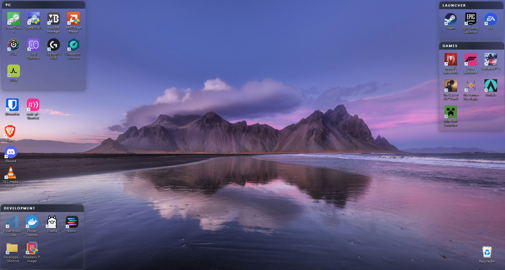
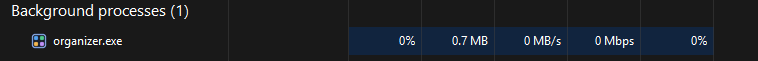
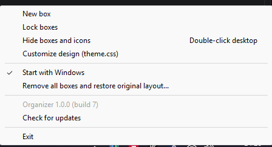

<p align="center">
  
</p>

<h1 align="center">Organizer: a free desktop icon organizer for Windows</h1>

<p align="center">
  Group your Windows 10 and Windows 11 desktop icons into glowing, translucent boxes that you can style with CSS.
  Free, open source and lightweight.
</p>

<p align="center">
  <a href="https://github.com/EnzoPENISSON/Organizer/releases/latest"></a>
  <a href="https://buymeacoffee.com/enzop2503o"></a>
</p>



Organizer cleans up a cluttered Windows desktop by grouping shortcuts, files and folders into
boxes you can move, resize and rename. Built to stay out of the way: about 2 MB of RAM, almost
no CPU, and it stops checking entirely while a fullscreen game runs.



Your files never move. Boxes only control where the real desktop icons sit, so opening,
renaming, right-clicking and dragging icons all work as usual.

## Features

- **Desktop boxes:** group desktop icons into boxes, and drag icons in and out
- **Roll-up boxes:** fold a box down to its title bar to tuck its icons away, and open it again in one click
- **Hide the desktop:** double-click empty space to fade out every box and icon
- **Hide the Recycle Bin:** one checkbox in Settings, no digging through Windows menus
- **CSS themes:** change colors, borders, glow and fonts with a `theme.css` file
- **Lightweight:** native Rust, about 2 MB of RAM, no browser engine
- **Game friendly:** pauses itself while a fullscreen game runs
- **Safe:** never moves or changes your files, and restores your original layout in one click
- **Automatic updates:** checks GitHub releases and installs new versions
- **No admin rights:** installs for your account only

## Install

Download `Organizer-Setup-….exe` from the latest
[release](https://github.com/EnzoPENISSON/Organizer/releases/latest) and run it. It installs
for your account only (no admin rights) and can be removed from Settings > Apps.

## Build from source

```
cargo build --release
target\release\organizer.exe
```

To build the installer too, install [Inno Setup 6](https://jrsoftware.org/isinfo.php) and run
`ISCC.exe installer\organizer.iss`.

Organizer runs from the system tray (it may be under the `^` overflow arrow).

## Use

| To | Do this |
| --- | --- |
| Create a box | Tray icon > **New box**, right-click a box's title bar > **New box**, or right-click the desktop > **New box** (on Windows 11, under **Show more options**) |
| Add an icon | Drag it into a box |
| Remove an icon | Drag it out of the box |
| Reorder icons | Drag an icon within its box |
| Choose how a box arranges its icons | Right-click its title bar > **Arrange icons** > **Automatically, each new icon after the last** (no gaps), or **Where I drop them** (each icon stays in its cell, empty cells allowed, dropping on a taken cell swaps the two) |
| Move a box (its icons follow) | Drag the title bar |
| Resize a box | Drag the left, right or bottom edge |
| Rename a box | Double-click the title bar |
| Roll a box up or open it | Click the arrow at the right of its title bar, or right-click the title bar > **Roll up** / **Expand**. Drop an icon on a rolled-up title bar to add it |
| Delete a box | Right-click the title bar |
| Change the color or design | Tray icon > **Customize design (theme.css)** |
| Hide or show boxes and icons | Double-click empty desktop space, or tray icon > **Hide boxes and icons** |
| Open the settings | Tray icon > **Settings...** |
| Turn off hiding on double-click | Tray icon > **Settings...** > untick **Double-click the desktop to hide boxes and icons** |
| Hide or show the Recycle Bin | Tray icon > **Settings...** > **Hide the Recycle Bin on the desktop**. This is the same switch as Windows' *Desktop icon settings* |
| Prevent accidental moves | Tray icon > **Lock boxes** |
| Start at login | Tray icon > **Start with Windows** |
| Check for updates | Automatic twice a day, or tray icon > **Check for updates**. When a newer release is out, click the notification or **Install update**: the installer runs and Organizer restarts |
| Undo everything | Tray icon > **Remove all boxes and restore original layout...** |

Deleting a box leaves its icons where they are. Moving a box over loose icons adds them to it.
A box grows when it is too small for its icons.

Double-clicking the desktop fades the boxes and icons out, leaving only the wallpaper.

<p align="center">
  
</p>

## Customize with CSS

Open `theme.css` from the tray menu. Save it and your boxes update within a second. A mistake
never breaks anything: the bad line is ignored and noted in `organizer.log`. Delete the file to
get the default back.

The box color is `--accent` in `:root`, used anywhere with `var(--accent)`. It defaults to
graphite (`#3B4252`) and applies to every box.

```css
:root {
  --accent: #3B4252;
  --panel: rgba(10, 12, 20, 0.85);
}

.box {
  background: linear-gradient(160deg,
    color-mix(in srgb, var(--accent) 16%, transparent),
    rgba(10, 12, 20, 0.12));
  border: 2px solid var(--accent);
  border-radius: 16px;
  box-shadow: 0 0 24px var(--accent);
  padding: 6px;
}

.title {
  height: 32px;
  padding: 0 14px;
  background: linear-gradient(90deg, var(--accent), var(--panel));
  color: #ffffff;
  font-family: "Bahnschrift";
  font-size: 13px;
  font-weight: 700;
  text-align: center;
  text-transform: uppercase;
  letter-spacing: 2px;
}
```

This is a focused subset of CSS drawn natively, not a browser, which is why it costs almost no
memory. These are all the supported features:

| Selector | Properties |
| --- | --- |
| `:root` | `--accent` (the box color), and `--your-variables`, used with `var(--name)` |
| `.box` | `background`, `border`, `border-width`, `border-color`, `border-radius`, `box-shadow`, `padding` |
| `.title` | `height`, `background`, `color`, `font-family`, `font-size`, `font-weight`, `text-align`, `text-transform`, `letter-spacing`, `padding` |

- **Colors:** `#rgb`, `#rrggbb`, `#rrggbbaa`, `rgb()`, `rgba()`, `white`, `black`, `transparent`,
  `var(--name)`, `color-mix(in srgb, COLOR 40%, COLOR)`
- **Fills:** a color, or `linear-gradient(135deg, COLOR, COLOR, ...)` with evenly spaced colors
- **Glow:** `box-shadow: 0 0 BLUR COLOR`, or `none`. Offsets are ignored, so the glow is centered.
- **Lengths:** `px`, or `0`
- **Fonts:** use a font installed on your PC

Not supported: other selectors, hover effects, animations, images, and backgrounds behind the
icons. The box background is drawn over your icons, so keep it translucent.

## Good to know

- Organizer turns off the desktop's **Auto arrange icons** and **Align icons to grid** while
  boxes exist, because either would pull icons out of their boxes. It records the original
  settings and icon positions before its first change; the restore command puts them back.
- If an icon was dragged out of a box while Organizer was closed, it returns to the box at the
  next start.
- A new file only joins a box if Windows happens to place it inside one.
- Icons are checked after you use the desktop, and otherwise every 30 seconds, so a change made
  from another window (such as deleting a file in a box) can take up to 30 seconds to show.
- To close Organizer, use **Exit** in its tray menu. Force-killing it can occasionally leave a
  stuck, invisible process that blocks a new copy from starting until you sign out or restart
  Explorer, because its windows live inside Explorer.
- Mixed-DPI multi-monitor setups have not been tested.

## Files

State is in `%APPDATA%\Organizer`: `boxes.json`, `theme.css`, `original-layout.json`, and
`organizer.log` for errors and ignored CSS. Set `ORGANIZER_DIR` to use another folder.

`organizer.exe list` prints the icons Organizer can see. It does not move anything, but it does
create `theme.css` if it is missing. Run it with output redirected, for example
`organizer.exe list > icons.txt`.

## Code

- `src/model.rs`: box geometry and membership logic
- `src/theme.rs`: the CSS parser, and the default theme
- `src/render.rs`: draws boxes to pixels
- `src/desktop.rs`: reads and moves icons in Explorer
- `src/ui.rs`: tray icon, box windows, dragging and the check loop
- `src/store.rs`: saved state

Run the unit tests with `cargo test`.

The app icon is drawn by `assets/make-icon.ps1`.

## FAQ

**How do I organize desktop icons on Windows 11 or Windows 10?**
Install Organizer, create a box from the tray icon, and drag icons into it. Each box keeps its
icons together when you move it.

**Is Organizer free?**
Yes. It is free and open source under the MIT license, with no ads, accounts or telemetry. Its only network use is checking GitHub for updates.

**Is it an alternative to Stardock Fences?**
It covers the same basic idea of grouping desktop icons into containers, as a small, free and
open-source app. It does not try to copy every Fences feature.

**Does it move or change my files?**
No. It only changes where icons appear on the desktop. **Remove all boxes and restore original
layout** puts every icon back where it was.

**Does it slow down games?**
No. It uses almost no CPU and stops checking entirely while a fullscreen app runs.

**How do I uninstall it?**
Settings > Apps > Installed apps > Organizer > Uninstall. Run the restore command first if you
want your original icon layout back.

## Support

Organizer is free. If it tidies up your desktop, you can buy me a coffee:

<a href="https://buymeacoffee.com/enzop2503o"></a>
